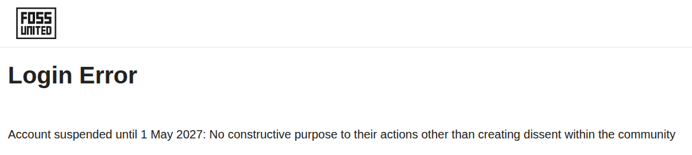

# Background Story

I have been volunteering at FOSS United for the past two years in various capacities. I have served as a Co-Chair of IndiaFOSS 2026, and 2025. I was instrumental in taking the idea of devrooms (suggestion from Nemo), implementing it in 2025, and scaling it up a bit in 2026.

I also served on the first ever elected Governance Goard of FOSS United, and stepped down recently to spend more time on volunteering. Almost all along my tenure, I had operated with trust towards everyone in the foundation. On the way out, I caught the whiff of mistrust from the CEO (also director) of FOSS United.  Thing is that he had kept me - a key member of the GB, and potentially others - in the dark w.r.t who were continuing on the GB. Now, this level of "gaming" immediately aroused my biggest suspicions, but the sheer timing of it - just a week before IndiaFOSS 2026, held me back. After the conference, I swung into action. My trust broken enabled me to look at everything that FOSS United had been doing with fresh eyes. I suspected that my trust had been severely betrayed on multiple occassions.

But I also realized that now that I was out of the GB, I had no way of getting the data I needed. So, I proposed an RTI mechanism on the forum. And promptly, the CEO of FOSS United ghosted me. So I swung into the act. From all my learnings, I published a long post, "What ails FOSS United" on the FOSS United Forum. Now, I had discussed this a bit with another Director, and indeed sent him the link to the article at 12:30 PM one fine day. Surprisingly, at 11 AM (close to midnight) he flagged by post and took it down, all by himself. In his spite, he also flag and hid another post by a community member. I exposed him and filed a code of conduct charge against him, which hasn't been resolved yet.

The "powers that be" at FOSS United have consistently refused to open it up, and indeed I haven't even now (Nov 11), got any information from them about what exactly they found objectionable there. Banning was almost instant ! This is a high level of CENSORSHIP already. Note that you can easily access the original here: "[What ails FOSS United](what-ails/what-ails-FOSS-united.pdf)".

"what ails" had not revealed everything of course. I had kept some cards with me - including the fact that the GB was kept in the dark. I next created another post, a [Signature Campaign against the CEO](https://forum.fossunited.org/t/upvote-rahul-resign-signature-campaign/9491). It garnered a lot of attention, and things got too hot for the CEO to handle. Which finally forced more censorship - the thread was LOCKED. Neither the CEO nor the other director, nor his sidekicks responsded on any questions on the topic.  However, Swastik Baranwal, ex-GB Member posted that the CEO must respond first.  Unfortunately, that did not happen at all.  Not only that, 2 more GB members who continued (Bodhish and Bowrna) and 1 more GB member who "supposedly stepped down" Nemo, did not respond either.

No information was shared with me about why the thread was locked. I started a new post [Locked Thread of Signature Campaign](https://forum.fossunited.org/t/locked-thread-of-signature-campaign/9579), asking various questions. A troll temporary account "praveen_singh" (created during the signature campaing) meanwhile showed up again on that thread. So I was then effectively forced to [post my campaign on LinkedIn](https://www.linkedin.com/feed/update/urn:li:activity:7523978760191164416/).

Then I posted another thread on the forum which clearly showed that the CEO, also a Co-Chair of IndiaFOSS 2026, asking for favours (talk!) for a sponsor, which is against the policy. With that, my account was suspended till May 2027.

I asked for the reason over email, and as usual the CEO+Director didn't have any "specific" reasons. Instead, he vaguely pointed me to this link: https://forum.fossunited.org/u/corpo-rate_kumar/summary , which shows:

> Reason: No constructive purpose to their actions other than creating dissent within the community

This was interesting of course, as there were two other threads running on which I was the only contributor.  The FOSS United forum is generally not so active. People with project grants generally come and post there as a rule. But these two threads were an exceptionan I was the only major contributor there.

I have skipped some of the deatils above. Multiple instances of censorship essentially happened over time here, with me losing access to moderator, telegram, desk tool and finally getting locked out of my forum.
