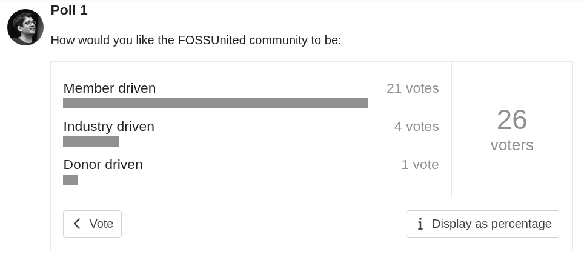
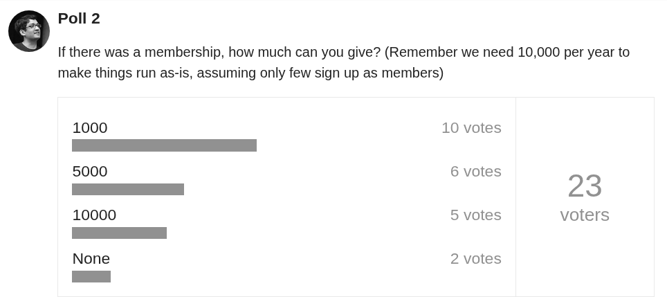
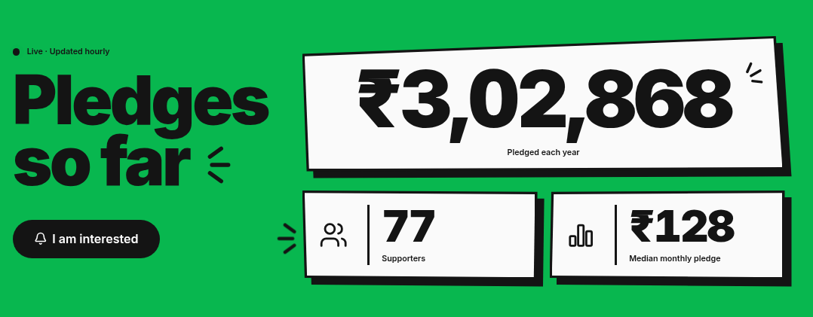
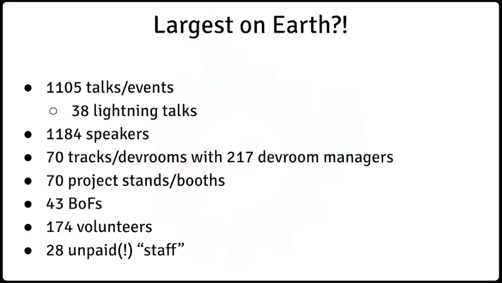
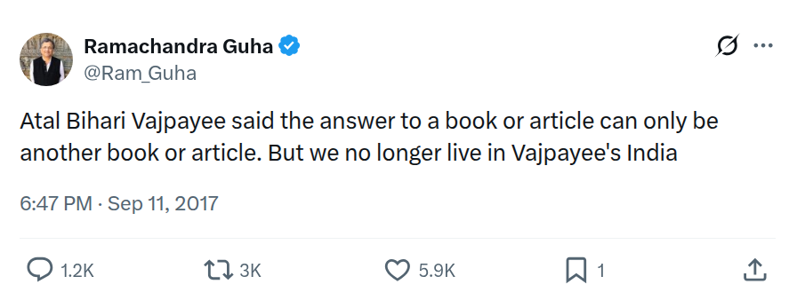

# Introduction

This is a follow on document to my elementary yet fundamentals based tome, “What ails FOSS United”. "What ails” seeded a major controversy, but not due to its content. It annoyed the “powers-that-be" -- the self-appointed moderators of the FOSS United Community, which were Staff and even a Director of FU masquerading as “volunteers”.

FOSS communities have a good history of debate, but not a patch on the fundamentally Argumentative Indian! The initial arguments were good enough to shake many out of their slumbers.  And in the process, many members whose last posts were a year more ago - found a voice back in their home. That was a delight to see!

## "AIDS" or aids ?

The title of this tome is easy to miss. And hence this novelty is called out separately. "AIDS" of course stands for Acquired Immuno Deficieny Syndrome. In the case of current FOSS United, Deficiency acquired due to what ? Dependence on Money. Too much outsourcing. Too little volunteering. Less to no sense of ownership.

AIDS in lowercase is aids, meaning help/assistance, etc. What helps us? Focus on grassroots contribution, volunteering, distributed decision making, community led initiatives.

In nature, there is duality everywhere. The choice of title is a silent upvote of this fundamental reality.  This document covers both the disease and the cure, for FOSS United.

# Author

Shree Kumar aka "Corpo-Rate"

License: CC-BY-SA-4.0

# Reference Material

The following links are referrence materials. If you've already seen them, then nothing to be done. They are called out where required in this document

  * "What ails FOSS United" is my well-known 22 page PDF. Accessible [here](https://github.com/shreekumar3d/foss-united-scam/what-ails/what-ails-FOSS-united.pdf).
  * Shree's comments delivered as part of the GB reflections session at IndiaFOSS 2026 [YouTube Link](https://youtu.be/16jUf3fLtsw?t=12567)
  * "What must IndiaFOSS be, in 2027?" 10 minute talk in Communi-Con @ IndiaFOSS 2026. [YouTube Link](https://www.youtube.com/watch?v=boNCSaCb138&t=7950s)
  * The Rupee Fund, Governance [https://github.com/RupeeFund/democracy](https://github.com/RupeeFund/democracy)
  * FOSS United Annual Report for FY25-26. [https://files.fossunited.org/FOSSUnited/Annual%20Reports/report.pdf](https://files.fossunited.org/FOSSUnited/Annual%20Reports/report.pdf)
  * [Rahul, Resign](https://forum.fossunited.org/t/upvote-rahul-resign-signature-campaign/9491) - My Signature Campaign on FOSS United Forum. Since I have been locked out of the forum, the same campaign [is on LinkedIn too](https://www.linkedin.com/feed/update/urn:li:activity:7523978760191164416/)

All financials mentioned in this document are w.r.t the FY25 annual report of FOSS United.

# EEEZY Framework

This document defines the EEEZY framework to fix FOSS United - cure it of the **AIDS** (in the sensor of the "ails") afflicting it:

- **E**fficiency
- **E**ngagement (Community)
- **E**mpathy - can be measured by our ability to attract diverse communities and individuals, and making them feel welcome.
- **Z** Large Donors and Contributors
- **Y** or You Factor -- i.e. volunteer contributions.

# What _really_ AIDS FOSS United

The AIDS metrics below clearly illustrate what AIDS FOSS United.

## Efficiency

FOSS United Foundation is a Section 8 Not-For-Profit Entity, which has 80G, 12AA, CSR-1 registrations/certifications. The CSR-1 status allows FUF to tap into 2% CSR spends by the corporate sector under Section 135 of the Companies Act.

The administrative overheads (salaries, operations, audits, office, etc) of a NGO in India are not more than 15-20%. An NGO must apply 85% of its income to its charitable objects in a year. FOSS United has a total income of 2.92 Crore. By these thumb rules, its administrative overheads must be in the range of 50 lakh rupees, tops.

Where does FUF stand in FY25 ? FUF spent 1 crore on salaries, 14.5 Lakhs on travel, 3.2 Lakhs "miscellaneous", 7 laksh for accounting, etc all totalling to 1.4 Crore or more - i.e. almost 3x the overheads of an NGO at the high end. FUF gave out grants worth Rs 33 Lakh rupees. FUF was forced to put 54 Lakhs in an FD to avoid showing excess "profit", courtesy poor planning. FUF spent almost 65 Lakhs on events, with 48 Lakhs on IndiaFOSS 2025.

Overall, FUF seems to be in a league of its own w.r.t levels of _FLUFF_ ! Almost 50% overheads, just 33% benefit to the community, and 17% money left over due to gross mismanagement.  FOSS United's performance as an NGO seems pathetic, truly.

The Staff work mostly remote, without much coordination and cohesion - the lack of which is sorely felt during large events such as IndiaFOSS. This is a massive problem for a young team. A responsible CEO would play a guiding and mentoring role, not a remote one.  The "new normal" of COVID is long forgotten, but flourishes in FUF - heh, even I would want to have such fun out of college. But is it useful, efficient ? Naah.

## Engagement

Almost everyone agrees that IndiaFOSS is the best positive outcome coming out of FOSS United.

The annual report mentions counts of Event RSVPs to inflate numbers to 14 thousand, but conveniently skips reporting actual attendance. RSVPs are free. Assuming 20% show-up, the actual attendance in these events across all chapters would be roughly comparable to IndiaFOSS itself... That too across Chennai, Mangalore, Bengaluru, Delhi, Lucknow, Hyderabad, Mumbai and Pune. Shocking ?

FOSS Clubs are, all said and done, distributed efforts that are too diffuse to be measured and counted meaningfully.  It is almost certain that the same colleges have been running any number of hackathons, workshops etc - efforts that would surely dwarf the efforts of these "FOSS clubs".

## Empathy

Even after running a "diversity" initiative for 2+ years and having dedicated Staff to the cause, the annual report includes this unfortunate cop out:

> But we are yet to meaningfully incorporate DEI work across the breadth of work at FOSS United, let alone articulate and achieve the goals we had for the Diversity Scholarships program at IndiaFOSS in the first place. Our efforts to find long-term partners to work on improving diversity have also been in vain, since most diversity scholarship recipients don’t continue engaging with the FOSS ecosystem after the event, as far as we are aware.

The "diversity sponsorship" program under IndiaFOSS is the best funded such program. Even after 3 years (as of IndiaFOSS 2026), it is riddled with issues including basic problems such as highly delayed intimations to selected scholars. I have been on record for more than a year, saying that the scholarships must be announced at-least 2 months+2 days in advance of the conference to account for train ticket bookings.

These failures are directly attributable to leadership -- failure of imagination, lack of ideas, application and execution. There is no dearth of available resources - just that 50 Lakh "saving" in FY25 could run umpteen things!

## Z

Large donors generally do so because they have a belief in a cause. FOSS United has two such large donors as of now: Zerodha and Samagata Foundation, totalling 1.9 Crore rupees. These are "no-strings-attached" grants. This has caused such laxity that CEOs and Directors have to be "pushed" to create an Annual Report - a routine activity in any NGO.

Ticket sales are the next big heading under income, Rs 18.39 Lakhs (for IndiaFOSS 2025).

Beyond that, the significant contributions come from Companies - typically as sponsors of events, totalling 28 Lakhs from 13 sponsors (again for IF25).

One large donor - Frappe has specifically pushed their contribution to ZERO. It is clear that they have stopped supporting FOSS United in "general". They have moved to a model where they provide support when their causes align with those of FUF. Examples are IndiaFOSS 2026, and the recent [MumbaiFOSS 2026](https://fossunited.org/c/mumbai/2026).

Clearly, FOSS United, with it's salary bill itself of 1 Crore rupees, cannot survive without large donors.  FUF's lavish lifestyle spending of 1.4 Cr overall needs a massive haircut.

## Y Factor

FOSS United events are run by volunteers and "volunteers" (paid Staff, including Director/CEO call themselves volunteers!!!).  FUF spends 1.4 Crore on "volunteers", as mentioned earlier (see "Efficiency").

Across the various initiatives, how effective are these "volunteers" in involving true volunteers, and can we place a value on this volunteering by itself ?

For IndiaFOSS, I (Corpo-Rate) have estimated my time spent as something in the range of 2 months. That's 1/6th of 1 Crore, or Rs 17 lakhs, give or take. Let's say we evaluate each of the 100 in-person volunteers at IndiaFOSS at 10k a day. That's 20 lakhs. If we tack on 13 lakh more as miscellaneous(reviewers etc), we only reach 50 lakhs. Then let's say increase it by 50% to account for all volunteering across all events. We reach 75 lakhs.  That is - less effort from volunteers than "volunteers" overall, even in the best case - a ratio of 3:4. If we add the overheads of "volunteers", then things look even worse - 75 lakhs vs 1.4 Crore... or 1:2 almost !

To be worth it, FUF's staff must have a target of at-least 3X salary cost in terms of community involvement.

One way in which FUF staff have tried to involve some people and "generate" activity is by giving grants, and requiring them to post updates on the forums. Most of the updates posted on the forum fall in this category. FOSS Clubs and Grantees coming and posting routine updates.

Now -- what can't be disputed is that relative to the rest of the population, people engaged in FOSS activites are relatively well paid.  E.g. when I (Shree aka "Corpo-Rate" Kumar) started my career in 2000, Linux was just starting to make inroads into IT. Us engineers were convincing the "suits" and the "lawyers" to adopt FOSS. Things exploded after 2004-2006.  Anybody who thinks 90% of the Industry runs on FOSS must ALSO acknowdge that a lot of those salaries go to people maintaining that software too. Indeed, FOSS which was a hobby of the past has no been reduced successfully to "open source" which is mostly done in companies. So much so that even pure FOSS software such as Blender is impacted - as evidenced by 60-70% of the attendees of BlenderCon coming there as part of their work. IT pays handsomely, and to that extent we should not believe absurdities like "Industry must fund FOSS".

One of the co-founders of FOSS United, Rushabh Mehta is THE person who has pondered about this the longest. Indeed, he tried to move FUF to a community funding model as far back as [Oct 2023](https://forum.fossunited.org/t/discussing-governance-for-fossunited-at-indiafoss/2465).  Rushabh also ran two polls also, at that time. This one :

And this one:

As you can see, the number of takers for the higher tiers were very less.

Industry follows the norms of the capitalist system mostly, which I have succintly written about in the same thread(the second reply in that thread is mine):

> Industry will support the community to the extent that there are benefits.
> More the members, greater the possibility of industry support too, both
> directly via member involvement, and indirectly via visibility.

Right now the problem is that almost nobody is putting in any kind of money, so the sense of ownership is low. Rushabh used to ask for annual reports, spend etc. Then I guess he(or Frappe) figured a better way - the Industry Sponsorship stopped from Frappe side, and thus there was no need to ask for it ! That's the real tragedy... "No-strings-attached" funding does have a problem, and indeed even creates problems when you place ample resources in the wrong hands. And we have explored this limit for a while now... Indeed in a way I have even suffered it.

To appreciate this problem, let's switch to a fun tale from the epics!

## A Tale of Generosity !

Story text credit: [servicespace](https://www.servicespace.org/blog/view.php?id=15897). This is a very common tale btw, and I just skipped the work of writing it down again. This part is not CC-BY-SA-4.0.

Once Krishna and Arjuna were walking towards a village. Arjuna was pestering Krishna, asking him why Karna should be considered a role model for all Danas (donations) and not himself. Krishna, wanting to teach him a lesson snapped his fingers. The mountains beside the path they were walking on turned into gold. Krishna said "Arjuna, distribute these two mountains of gold among the villagers, but you must donate every last bit of gold".

Arjuna went into the village, and proclaimed he was going to donate gold to every villager, and asked them to gather near the mountain. The villagers sang his praises and Arjuna walked towards the mountain with a huffed up chest. For two days and two continuous nights Arjuna shoveled gold from the mountain and donated to each villager. The mountains did not diminish in their slightest.

Most villagers came back and stood in queue within minutes. After a while, Arjuna, started feeling exhausted, but not ready to let go of his ego just yet, told Krishna he couldn't go on any longer without rest.

Krishna called Karna. "You must donate every last bit of this mountain, Karna" he told him. Karna called two villagers. "You see those two mountains?" Karna asked, "those two mountains of gold are yours to do with as you please" he said, and walked away.

Arjuna sat dumbfounded. Why hadn't this thought occurred to him? Krishna smiled mischievously and told him "Arjuna, subconsciously, you yourself were attracted to the gold, you regretfully gave it away to each villager, giving them what you thought was a generous amount. Thus the size of your donation to each villager depended only on your imagination. Karna holds no such reservations. Look at him walking away after giving away a fortune, he doesn't expect people to sing his praises, he doesn't even care if people talk good or bad about him behind his back. That is the sign of a man already on the path of enlightenment".

Moral of the story - the CEO is attracted to the gold ! His salary is 33 lakh rupees, which is roughly equivalent to 1 Crore rupees (3x) by my "Corpo-Rate" metrics. That's not a personal attack, btw. Even I failed to recognize this fundamental issue earlier when I was in the GB.

End of story...

# Mountains of Gold

What are those two mountains of Gold in the FUF ? 1.9 Crore in money from Zerodha and Samagata, of course. Let me engage your imagination for a moment about what we can do with these mountains of gold:

- 4 IndiaFOSS events without sponsors ! (note current IndiaFOSS is not a great model - costing almost 50 Lakhs. But even with that, it's 4 a year)
- 1 IndiaFOSS + event grants of 1 lakh rupees to 150 events !
- 1 IndiaFOSS + event grants of 10 lakhs to 5 events (CityFOSS conferences) + 100 event grants of 1 lakh rupees

These are rough numbers. But hope you got the magnitude of the mountains of gold. Now with the current Staff led model, 3 IndiaFOSS is just staff overhead. Less than 1 IndiaFOSS is grants ! Most of the "effort" that is going in distributing these mountains of gold are going to the people who are trying to partition those in vain.  And even worse, the beneficiaries don't even see that there are two mountains there.

But even with those mountains - the question of ownership remains. Donors have given away those, but without any sense of ownership of the community in the pile, we will all be the losers. Those sitting by the side and complaining that they aren't getting anything must first be enabled to participate in the distribution. To prove that they are serious, they must first put some of their own skin in the game.

I was in the first ever elected GB for FOSS United.  We were all sure that we wanted "FOSS United" to be a "community led" thing. Staff would be facilitators, but not "drivers".  Indeed, I almost created a role model of this by driving more than half IndiaFOSS (devrooms, facilities and even main track curation). But the thing with "power" is that those in "power" get a weird idea that the benefits are accruing due to them. And so it happened with FU inspite of these discussions.  Instead of easing out and aiding community efforts, CEO & Staff were actively trying to sabotage the mission by increasing the scope of their own work. Notable things - larger allocation for grants, the self-alienating mission termed "Right to Learn" and the "FOSS festival" branding.  Now for these, they hired more interns(more costs!), which ended up increasing their own workload, and converted their primary job - helping run IndiaFOSS into "_mission impossible_". See "what ails", for details.

# What _actually_ aids FOSS United

More precisely, this section must be titled, "what actually aids the stated goals of FOSS United". And what are those stated goals ? From the website:

> FOSS United is a non-profit foundation that aims at promoting & strengthening the Free and Open Source Software (FOSS) ecosystem in India.
󠀠
Does it say anywhere that the aim is to hire more staff ? It clearly says "non-profit" - and what thay should mean merits a closer look.  Every non-profit must firstly have a sense of mission.  And whether it is true to that mission can only be evaluated by the results - not by the "intentions" of the executors.

## Efficiency

A useful rule of thumb for any Indian non-profit is that the overheads must not exceed 15%.  In the context of the 1.9 crore rupee grant, this translates to 30 lakh rupees. That includes salaries, cost of office, travel, web infrastructure, etc etc. If we stretch this to 20%, we still end with 40 lakh tops. That's almost 1 IndiaFOSS expense unit...

What can we fit in this budget ? Possibly these:

- FT1 - 1 full time engineer (FTE) to take care of the "infra", payment systems, automation needs of the community etc
- PT1 - Part time role. 1 additional person who will act as a manager for FT1, interface with the community, and enable communities to run their own initiatives without getting into the way! (see below)
- Travel, etc for these two people
- Base web infra for the community
- DIR - Part time director to ensure statutory compliance. Minimum travel allowance for this role.

The GB (purely voluntary) would serve as a co-ordination body which talks to the community, and forms consensus on programs to be executed - through discussions on the forum.  Work groups would be formed.  These work groups use assistance from PT1,FT1 and DIR to run programs.

Ideally - FT1, PT1 and DIR are in the same location - Bangalore of course !

This structure is what I call FUFv3. FUFv1 was the one where the co-founders were playing lead roles, FUFv2 is Rahul & Co. FUFv3 is the community led avatar.

That's it - and that's all FOSS United Foundation must be. As a fun political analogy(you may call it a "dig" as well), this is indeed the very implementation of "Minimum Government, Maximum Governance".

## Engagement

IndiaFOSS 2027 is the primary and minimum goal of FUFv3. CityFOSS conferences will be the minimum extras, which will of course be community driven, just like IndiaFOSS.

IndiaFOSS 2027 will be community led. I had outlined some of the broad contours of IndiaFOSS 2027 in my presentation during Communi-Con, [What must IndiaFOSS be, in 2027?](https://www.youtube.com/watch?v=boNCSaCb138&t=7950s). The important points there were:

 1. Ideally happens in a university. We save ~10 lakh, and rid ourselves of logistics headaches. A lot of large engineering colleges/universities run multi-mega conferences on a daily basis - it's not a novelty !
 2. No food included in ticket cost. Only volunteers, speakers/workshop hosts, and sponsors will get food from the conference, included in their ticket.
 3. Food coupons can be purchased by other attendees in advance. There will be other options in the venue . e.g. food truck, college canteen, or other options at a walkable distance.
 4. Devrooms as part of the conference launch. I had already sounded out the existing devrooms, and have reached out to others too.
 5. Student crowd curated for "diversity", no ticket transfers.

These measures will already save us 20 lakhs. There are many useful ways to deploy this - travel scholarships for devroom managers, speakers, etc.

3,500 to 5,000 attendees must be goals for IF27.

I won't go into the full vision for IndiaFOSS, as this is the subject of another long article which I am writing. But I will just point out one thing: if we just do IF27 and nothing else, then the rest of the money will be used for what ?

Till IF26, we were selling tickets... what if invert the logic and make a lot of tickets with scholarship ? We would have more than One Crore rupees in hand (assuming roughly 40 lakh kept apart for CityFOSS). With that we can give a thousand scholarships with a max cap of twenty thousand rupees (picking an arbitrary number for simplicity). If we do that, then IndiaFOSS 2027 will be the MOST prestigious conference in India ! Let that sink in...

Oh btw - if we do this well, then at this point, Sponsors will be behind us, unless I am mistaken. If we reach 5k IndiaFOSS participants, we can easily raise 25L or more of sponsorships - purely based on inbound interest (i.e. no outreach)

## Empathy

Considering IF27 as the only goal, selection for at-least the student crowd can be curated for divestity.

Now, diversity is a widely misunderstood term, especially among the well heeled (i.e. most of you reading this!). I've seen that folks frequently look at "diversity" from a western lens. Let's not do that. We are India. The country that people said will not last as a democracy. Also the country which gave universal franchise at creation - without restrictions, to everyone. The sheer scale and diversity makes us the Elephant. We take sure, slow and steady steps. Are you familiar with how rapidly an Elephant picks up speed - go watch those videos ! We can do that with the right approach.

Before I get ahead of myself, let me explain what "diversity" actually means, including a formal sense. I’ve found that the word “diversity” is significantly misinterpreted to mean “affirmative action” (picking the most common misinterpretation). But it is not so. So what is diversity ?

India has been called the land of unity in diversity, melting pot of races, we have hundreds of languages, etc. In general, large Indian crowds tend to be reasonable “diverse” - as in "more representative" of India. But smaller samples of those ? Not necessarily - a good example of which is the IndiaFOSS crowd. How would you measure how diverse the conference was ? We don’t collect any attendee data right now, so that’s ruled out. And we can’t curate for diversity in the crowd of “merit” - i.e. the working professionals - as that may not be seen as appropriate.

I described in my talk "What must IndiaFOSS be, in 2027?" how the students are a more diverse crowd. Not all of them get into jobs, women are a higher percentage, and reservations for various quotas make it an interesting crowd. Going into an expensive college can’t guarantee anyone a job either - but then not all of those folks need jobs either. Get the idea of what diversity means ? It’s not “merit”. It’s representation, looked at from different aspects. Just so that you understand - an ultra rich student represents diversity, as much as somebody who is in 4rd year of engineering at age 26 (is that possible these days??), and similarly an exchange student from an African country studying in any college. We can do diversity on the basis of interesting attributes - e.g. which language is the mother tongue, location of college, etc.

Precisely speaking, Diversity curation is sampling various homogeneous pools for representation. Homogeneous pools are formed using data as the basis. But those buckets are formed for random sampling, not to discriminate based on attributes. Small pools represent outliers in the data - giving them better chances of being picked. Making high quality buckets may or may not need extensive analysis. We will know what’s required only when we get the data, which is possible if we implement the RSVP system that I have briefly touched up in "What must IndiaFOSS be, in 2027?"

## Z

The large donors are potentially with us at-least till March 2028 (ref: CEO claim of "tenure till March 2028"). That means we have some time to execute these ideas.

What will the landscape of FOSS or Open Source look like in that timeframe... Who knows anyways ?  Those who have paid attention to my "What ails" and are adequately grounded in FOSS United and the surrounding NGO circles must know by now that we have two people who can be called "Nostradamus". (no - not me!)

This section is short, and many of the key ideas here have been pushed under the heading "Profit" later in the doc.

## Y

Notwithstanding any known/unknown long term commitments from donors, we must look to get the community involved and put in their bit.

So - the right question to ask is... how can we enable individual contributions ?

### Funding for Events

Again, I had those answers in November 2003 ([see this POST](https://forum.fossunited.org/t/discussing-governance-for-fossunited-at-indiafoss/2465/10)):

> Would it make sense to explore a micro payments model for bottoms up democratic funding, unrelated to membership ? A meetup happens every month. Let’s say we put up a UPI barcode somewhere during the event. Inform the audience that we’re looking for participatory funding - no strings attached. Run this as an experiment for 6 months.
>
> No artificial bands/limits need to be placed on a fund transfer - we may get as less as less 10 Rs (“darshini chai”) to whatever - and we need to accept each equally. The hard part here would be not doing gamification or anything that would look remotely like “dark patterns” of fundraising (sorry - can’t the get right word here - but I guess you understand what I am saying here).
>
> There will be management overhead of tracking these micro payments, and I’m sure we have folks who know better how to take care of these things via automation - I can think of Nemo in this context already. It would be a fun project to make a box saying “FOSS United” with our own own audio - but that’s a side activity.

In general, for FUC events, we must have a policy of not paying for the venue.  Paying for a venue is typically a very large expense, and comes almost with very little benefit.  The content of an event decides whether people are willing to take the pain of showing up to a large extent, not the exact venue. Volunteers can help create a pool of free event spaces, and rotate venues, coordinate etc. This will work very well for monthly/bi-monthly meetups.

What about tea, coffee, snacks ? Those expenses must come from the participants.  If there was no event, and a few friends gathered, what would these folks do ? Exactly that is what we should enable people to do in FUC events. That would be our digital community infrastructure based on UPI.

Now, you might ask why would someone even want to do an FUC then in the first place ? If that's the question, then probably such organizers shouldn't be doing an event in the first place... Something to think about. The guiding principle of paying for a venue should be "what does it get us", not some assumptions made without reasoning.

Of course, I am not advocating for absolute policies at this moment - certainly CityFOSS conferences are an exception. And even in that, conferences like MangaloreFOSS would be torch-bearers (zero venue cost as of now). In "Engagement" section above, I had already kept 40 lakh rupees aside for CityFOSS events. That number of course is a representative number at this time, to be fixed later with discussions.

### Funding for Projects

With all that out of the away, let us attack the real elephant in the room.  Individuals contributing to FOSS United in their own capacity, in whatever way possible. Putting their foot where their mouth is - oh no oops... Skin in the game !

That's why we have been developing The Rupee Fund in parallel.  The idea is simple. Anybody interested can commit to Rs 15 a month. Funds are pooled together for 3 months at a time - what we call a "season". Only contributors have a vote, and only contributors can nominate a project for funding. Indeed, the right to nominate your own project is a fundamental right in The Rupee Fund community. Every season, the contributors vote - each voter can vote on multiple projects. Voting for more than one project makes it "fractional". Multiple winners are possible every season. The full scheme is somewhat extensive, and most of the details are documented documents of [The Rupee Fund democracy](https://github.com/RupeeFund/democracy).

At this point you are probably scoffing at the idea of The Rupee Fund. Did I hear you say... What can _fifteen rupees_ get ? Right now, we have about 80 people who have expressed interest, and guess how much they have collectively committed to in a year...

3 Lakhs a year. Would you have guessed ? Median monthly pledge is Rs 128. Turns out, if we provide the community the right options, then they know what is the best to do. Let's not second guess the goodness in each other, even for a moment.

The money going to The Rupee Fund will sit in a FOSS United account, so it's not as if it is going to some third parties. The Rupee Fund is a community initiative that has already shaped up nicely. All it needs is a final push - from everyone who believes.  If we get to a thousand subscribers then we should be in great shape for lift off ! At 1k subscribers, we will be at-least at the level of 20 lakhs of funding a year - 5 lakhs every 3 months.

The Rupee Fund will take of funding for "projects" in a democratic manner.  Whoever is contributing to The Rupee Fund only will have votes, so that's the best it can get.  Independent of whether you pay Rs 15 a month or Rs 1024, you get one vote. But what are these projects. Could be "anything", including a mix of proprietary and FOSS pieces, open core, open source, open design, open data, whatever. Voters decide what's kosher for their vote, and what is not.

But again I hear you ask.. what "projects"? Funding for specific events could be a "project" too. Question then would become... does the community back it in some way or not. The proof of the pudding would be in the voting. And no, it won't be a "popularity" contest, as the system allows for multiple winner - and the smaller projects (those that ask for less money, or those that the voters think are "more efficient" or "better") would have a better chance I guess.  In any case, I'd say "let the best projects win, chosen by the community".

The Rupee Fund also supports the concept of "matching grants", which is typically used in charitable causes. Let's say a sponsor is open to support FOSS United to the tune of Rs 10 Lakhs, but wants to do so if the community shows some commitment. This could become a project in the rupee fund. If that project raises, 1 Lakh, 10 lakh might get added as a matching grant (1:10 ratio as an example). So, FUF would get 11 Lakhs for some well defined task, with known executors, etc.

# CLI model for Employees

CLI is short for "Community Linked Incentives".  Employees would have a base salary. If the employee is part time, then the base salary is a "retainer" for some minimum work expected - agreed upon by the parties.  Beyond that, such employees could earn based on various activities.

Given there is only one part time employee -- PT1 -- is identified in this document, it helps to be a bit more specific about this role.

One unavoidable part of FOSS work at a Foundation is "advocacy". For FUF, where should we spend time doing advocacy ? In the community where it will have the maximum - and direct advocacy - i.e. the education system.  So, PT1 could be a highly skilled trainer who is comfortable doing workshops to a graduate level student community, talk to the education system, etc.  PT1 could get additional compensation - directly a function of their professional rate - this ensures that the impact of any such demands can be "measured" and properly accounted for.  Rationing, quotas, where to spend such effort, where not to could all be decided by the governance board. In a way, PT1 then becomes the travelling salesman for FOSS advocay in colleges. Not a role for young turks.

Employees could get a bonus - also based on voting. Fancy, I know - but see if we have a thousand voters, should we expect them to be unfair ? We have good GB election results !

What about existing skills such as Design that we already have full time staff in the foundation ? Now this is an interesting case, which adds value, so called out specifically. The problem is that - once we define IndiaFOSS and CityFOSSes as the Minimum - then there is not enough such work in the foundation to merit a full time job for that role. This could be contract work - and indeed this opens the interesting possibility that we could have open bidding!

Lastly, this model is of course not friendly to young employees. But that's exactly what's broken in our current system - it's almost impossible to have a growth path for young employees due to the non-availablility of folks with higher level of skill in areas where the yongsters may want to grow.

Beyond that, we could have another type of CLI too - "Community Leader of Initiative", whose incentives are also linked to their performance. Perhaps these are folks in the WGs, who are playing some key roles. They could also get renumerated and even paid a bonus via our extremely transparent version of "thanks.dev" - called The Rupee Fund.

# Directors of FUF

Role of the Directors:

1. DO : regulatory compliance, government facing work, paperwork, dealing with accountants etc
2. DONT : not empowered to decide the direction of the foundation. i.e. must be committed to let the community drive the direction, not self preferences
3. DO: ensure openness wrt availablility of data at all levels, to the extent possible

W.r.t openness, see the FOREST of FRUITs approach to RTI, [described in this post](https://forum.fossunited.org/t/rfc-rti-for-foss-united/9417/6).

# Profit and LTS

Yes - Long Term Sustainability. You read that right.

The three sources of funding for various aspects in FUFv3 are:

1. F1 Generic Donors, without a "specific purpose"
2. F2 Sponsors (events or specific "things", including in-kind)
3. F3 Community via direct payment methods
4. F4 Community via Rupee Fund

FUF will of course remain a not-for-profit foundation.

Profit is money left over as surplus at the end of the FY - and that will get managed actively under the FUFv3 regime due to its emphasis on up-front planning, openness and continuous collaboration.  Keeping money in an FD (e.g. the FY25 FD of 54 lakh rupees) would be done for well defined reasons, and a proper timeline, rather than on an ad-hoc basis.

The key goal of initiatives like F3 and F4 are to create the "escape velocity" necessary to achieve true independence from F1.  The reasons should not be lost on anybody who follows the leaders of those large donors. These leaders are rather open about the turbulent nature of regulation - and that at any time anything can change.  We must heed those statements well - well enough to actively look to build structures that reduce dependence, and even aspire to eliminate it entirely in a two year period.  Yes, we should remain thankful to those donors - but should we remain dependent ? No. We have much to thank these donors for - but real payback will be when we demonstrate that we can stand on our own feet.  The [roadmap of The Rupee Fund](https://github.com/RupeeFund/democracy/blob/master/doc/ROADMAP.md) has a partial, but helpful explainer too.

Note that the F1 "no-strings-attached" funding is actually being used right now to cover shortages in other initiatives.  E.g. to run IndiaFOSS, we need money because not everything is being raised through sponsors.  When we are able to scale IndiaFOSS to five thousand people and beyond, then finding sponsors would become way easier.  If we can make IndiaFOSS the world's largest FOSS conference - say Twenty thousand people, then we become an force to reckon. An industry of sorts, truly. Once we tip the scales with F4, F2 will grows large enough, and our dependency on F1 will be minimized. We'd still welcome F1 though - as that allows us to maximize goods. Savings from F2 would represent what we could't spend, and might go into FDs to help deal with future shocks.

And why should we even aspire for such things ? I have not the least doubt that we need the young professionals, and the students as much as they need us. Why is this important ? These folks are the future of the skill and trade, call it what you will.  Further, students are in trouble too. The AI tsunami has hit, well and truly.

Those who cannot remember the past are condemned to repeat it... And what past is that ? Back in the year 2000/01, the Kannada television sitcom "Danda Pindagalu" was popular.  Those were the days when the highlight of every episode would be the intro song - which would of course be extensive. Great serials had great songs to begin. Danda Pindagalu had meaningful lyrics, parts of which I'm putting in here:

|Original lyrics                                         |English translation                                              |
|--------------------------------------------------------|-----------------------------------------------------------------|
|ದಂಡ ಪಿಂಡಗಳು ಇವರು ದಂಡ ಪಿಂಡಗಳೂ...                         |Useless good-for-nothings these folks are... (google translated!)|
|BA BSc BCom ಮಾಡಿ... x 2                                 |They did BA BSc Bcom degrees                                     |
|ಕೆಲಸವೇ ಸಿಗದೇ ದಿನಾ ಅಲೆದಾಡಿ  x 2                          |They went roaming for jobs                                       |
|ಎಲ್ಲರ ಕೈಲೂ ಉಗಿಸಿ ಕೊಳ್ಳೋ waastu body ಗಳು  !              |And got derided as "waste bodies" by everyone                    |
|ದಂಡ ಪಿಂಡಗಳೂ... ಇವರು ದಂಡ ಪಿಂಡಗಳೂ......                   |                                                                 |
|ದಿವಾನ್ ಚಾಕರಿ ಇವರಿಗೆ ಸಿಗಲ್ಲ  ... x2                      |These folks won't get "high level" jobs                          |
|ಜವಾನ್ ಚಾಕರಿಗೆ ಇವರೇ ಹೋಗಲ್ಲ  ... x2                       |And they won't take "low level" jobs                             |
|ಅಲ್ಲೂ ಇಲ್ಲ ಇಲ್ಲೂ ಇಲ್ಲ . ಎಲ್ಲೂ ಇಲ್ಲದ ಅಂತರ ಪಿಶಾಚಿಗಳು ! ...|Hence they are stuck - neither here nor there..                  |

Kannadigas can listen in to [this on YouTube](https://www.youtube.com/watch?v=gxZShsBv3-s).

The basic translation of this is simple enough.  In that time, there were a lot of graduates that had BA, BSc and BCom degrees (even LLB I guess - but that wouldn't have made the cut for the lyrics). No jobs, and many years spent at home without a job. Social norms were somewhat different, economic conditions were not so good on an average. Thus, there was a sense of these folks being a "burden".  Now, does that mean there were "no jobs"? No sir, there were plenty - but these graduates would treat those jobs as beneath them/their capabilities.  The better jobs eluded most - resulting in these folks sitting at home.  Yeah, internet was nascent. No smartphones to keep you occupied. Libraries were local. And so were the typical timepass activies !! The end result - a societal notion that these folks are "waste bodies". The series aired in 2000/2001, but clearly it was based on lived experiences of a few years that preceeded the Y2K problem.

And how is this relevant now ? The tall waves of the AI tsunami are still travelling inland into the job market. It's common now to hear "where are the jobs" as much as "job losses". Economists are back with theories of "spending on infra" vs "spending on people". Depending on which self styled AI pundit you listen to, SaaSocalypse is imminent, and the job winter runs easily till 2030, if not beyond.  Are they right ? Who knows... but it has happened before - for folks who studied BA BSc BCom. But then life took a good turn after a few years.  Same will happen to our young community members too. The best way to survive this is by building human networks of collaboration, cooperation and trust. That's the future of FOSS United, as I see it.

What's the future of software enabled tech then, and why should we even this ? The analogy I like to make is plumbers and pipes. Pipes are an easily available commodity, and indeed anyone can put them together if they so wish. But plumbers yet retain their place. Thus, it stands to reason that software, or more accurately logic and system integration will survive as a requirement well into the near future.  The levels of abstraction will travel deeper and higher simultaneously. Where do you see your role ?

Keeping things open is how we ensure that we ALL can live long, and propser!

To end with, some philosphy, as usual.

ಧರ್ಮೋ ರಕ್ಷತಿ ರಕ್ಷಿತಃ 

धर्मो रक्षति रक्षितः 

dharmo rakshati rakshitaha

English is really a poor language, and nothing can capture the philiosphical essence of that single statement. But try we must!

What gets supported, supports the individual and the collective
What gets cared for, cares fthe individual and the collective
What gets funded, funds the individual and the collective
What we build, builds us ! (IF26 T-shirt)

I've now beyond "FOSS" - and instead prefer to use "software dharma" or "tech dharma" where suitable. So...

To fork is human, to merge is divine (IF25 T-shirt). A massive merge is what we need now, to meet the goals of all while working as one!

Peace!

# Odds and Ends

I've always seen volunteering at FOSS United, specifically at IndiaFOSS - as a skilling initiative.  Call me old school (I am 48!), but I do get dismayed to see us spending money lavishly on non-essentials... Food primarily, but also venue. And in general I have seen that the primary "volunteers" (Staff!) are very reluctant to do anything hands on. So anything that you propose that is not "their skill" gets silently thumbed down.  Of course, if you deliver everything end to end which doesn't threaten their reason for existence, they are still OK with it.  But if it competes with what they prize for themselves (large hall for "important talks" - never mind whether the audience thinks so or not), then bad luck.

Now, before I prooceed down this path, let me take a detour to FOSDEM. FOSDEM, for those unaware, is the world's largest FOSS conference - attracting more than sixteen thousand people every year. It happens in Europe. It is free to attend.  Lots of volunteers apparently help out. I don't know how many, I have never been there. They have an [extensive volunteer guide](https://doc.volunteers.fosdem.org/general/introduction/), which specifically calls out various [Volunteer tasks](https://doc.volunteers.fosdem.org/tasks/tasklist/): Van Loading, Buildup, Signage, Cleanup, Van Unloading, Cloakroom and Food Courier.  If you read through the documentation, you will find that some of this is serious physical work.  In fact, the [cleanup](https://doc.volunteers.fosdem.org/tasks/buildup-cleanup/cleanup/) page is quite specific

> removing furniture, sweeping, restoring spaces

Sweeping ? And this is happening in an advanced _western_ country ! So, let me ask the reader -- is this a "best practise we have to import", or a "local custom we have to practise" (I sweep my own home btw) ?

Richard "RichH" Hartman had this slide in his [IndiaFOSS 2025 talk](https://youtu.be/_wbqbblIexY?list=PLOGilj110olxij6kbNUlRdd3Ez8bWczny&t=2445):

If folks in an advanced country, and more resources, can run a conference with so much volunteering, what stops us ? Paid Staff is not a necessity. FOSDEM is a good example already. And we have plenty of people. In fact, IndiaFOSS allows gives each devroom 6 tickets - double of what FOSDEM gives. We had 100+ volunteers for other various things too.

I am specifically proud of IndiaFOSS 2026 in a way, because of the way the network got done.  I guess most did not see the hardwork in putting it all together - kilometers of wire were laid, carefully, involving real physical work.  It was such a breath of fresh air - and I could myself scarcely believe it - to see even a College professor - lead from the front, climb a collapsable ladder and help route that ethernet wire precisely so that it could enter Auditoriums without getting pinched by the door.  And Prof Mohit (now a GB member) was so careful about costs that this deserves mention. He had asked for IPv6 addresses, and the vendor was quoting 10k + GST. I was telling him it's OK we spend so much on the conference, we can buy it. But no he did not take it - he found alternative solutions.

And I have to contrast this specifically with IndiaFOSS 2025. Volunteers were complaining because they had to carry water cans.  I ended up telling them sorry on the forum - no less!  But that episode did tell me what volunteering must _not_ be.  If volunteers at a renowned conference in the world can take out trash, what ails the Indian volunteer - I asked myself silently... And let's be clear -- I make my own choices, not those of others.

I have proposed various ideas which didn't get much support from the foundation.  Most recent example being [Bangalore Darshan (Forum Post)](https://forum.fossunited.org/t/rfc-community-curated-lunch-at-indiafoss/8677), which was mooted as a community curated lunch on Day 2 of IndiaFOSS. The traction was low, the staff didn't adapt it - so outreach suffered. As simple as that. I also proposed separating food costs from ticket last year. That didn't find much takers either, even then.

Have to mention the recent effort of photo+video capture by Ganesh and Team. Ganesh had volunteered for IndiaFOSS, and out of the blue reached out me. He pitched the idea of shooting generic videos. Said he had a team from 3 colleges. 20 students. I said -- come IN, run ! More volunteer power. Arranged the cameras, lenses, etc. Pushed them to work out the scope with Staff. Got everything covered including the devrooms, halls, community booths.  It was cost effective, and it worked ! We have photos online now, and decent coverage.  Was it perfect ? Hardly. Was it effective ? Very effective - we got tons of photos. Did it help build a sense of community among volunteers -- YES ! Did it help build skill... I think so!

Overall, we need to use that spirit of community and channel volunteer energy to run events. If funds are assured through principal sponsors for a few years, that's a time cushion that can be easily be put to great benefit. Slim Staff + GB + Work Groups + activated community is the cocktail that will propel us forward, not self-serving paid Staff.

# Afterword

So there you have it - if somebody were to put a contemporary political spin on it - then they could just call this my version of "Rahul _mukt_ FOSS United".

Many have noted the sense of urgency in my push here, and even asked me to "slow down". Many Staff are spreading insuinations that I am showing them "malice", and some are calling me negative. Nothing could be farther than the truth. In fact, show me someone in the history of FOSS United who has gone through the pain of documenting at great length not just the problems, but also potential solutions.

There is a reason for my urgency - and it is pure economics: the Salary bill per year of the staff is 1 crore.  Monthly 8 lakh rupees a month. Every week the Staff "works" on their "agendas", the cost to the community is 2 lakh rupees. This is highly wasteful, and even more so in our where funds are in perennial shortage.

Simple example - consider the size of FUF event grants (see page 31 of Annual Report) varies from five thousand to one lakh (rare - only one), totalling to 4.4 Lakh rupees, with an average of around 27 thousand, and a median of 22.5 thousand - and that's a mere 17 grants all together.  It's easier to do an open call -- all our communities are heavily networked anyways -- and run a selection process on top of that. Then we could have 1 lakh rupees easily given as a weekly grant - all through the year.  This single example is enough to show how wasteful the Staff expenditure is, in the overall scheme of things. The closed door selection system also creates a sense of "obligation" in those who receive grants. The grantees are clearly crediting the CEO/Staff as the "givers" of such grant, rather than the community around FOSS United, which has already been counterproductive in many ways.

This document sets the common minimum program - not a 100% equivalent of whatever FOSS United currently does. Rest is up for community discussion, Workgroups, GB, etc. There would be some kind of "step changes" moving from FUFv2 to FUFv3. Whatever current grants are committed right now could get disbursed. But new grants may not be approved by Staff, etc. Headcount reduction looms. That sounds inhumane, I know. But in this document, I am trying to suggest the solution, but not saying it will happen tomorrow. But I hope this can certainly happen and finish over this financial year.

Majority of the work done under FUFv3 would be done by Working Groups(WG), which will have NO employees. That said, WGs will have financial empowerent - which is already part of the current framework.  As a best practise, WGs could be encouraged to maintain some kind of effort tracking.

Who is IN ? Sign up to the Rupee Fund first :) [https://rupeefund.org/](https://rupeefund.org/) . Student or Pro, we need you _bro_! Starts at Rs 15. Let's build a healthy self sustaining  community.  Don't think what the "others" will think or do, do what you must - first ! That's my appeal to you, with folded hands, no less.

Yeah - and while you are at it, UpVote my campaign and DownVote the CEO, King and Emperor of FOSS United. Take your pick:

    * Upvote my [Rahul, Resign! Signature Campaign](https://forum.fossunited.org/t/upvote-rahul-resign-signature-campaign/9491) on the FOSS United Forum, if you have an account there
    * Like and SHARE the [same campaign on LinkedIn](https://www.linkedin.com/feed/update/urn:li:activity:7523978760191164416/)

And.. Thank you for your attentinon to this matter !

# Critiquing this Document

Let me remind you - dear reader - that critiquing this _tome_ will need time and effort. It's a full *system*, not just a single idea. If I explained every aspect in detail, it would become a _thesis_.  So keep that in mind.  Rupee Fund has a lot of governance ideas documented reasonably well - including a moderation system based on "positive" and "negative" karma. Do check those out too.

My request is you let these ideas sink in for a while. Low effort comments such as : "This won't work" or "I think blah blah" won't be useful.  That is no claim btw that this work is perfect. Just saying that having "simple opinions" won't be useful. If something is not clear, do ask w.r.t a clear scenario or example !  If you have a serious comment/critique, explain where you are coming from, what your experience has been, and why something won't work. Plus suggest improvements in the same vein.

Let me quote the well-known Ramachandra Guha ([see Twitter Post](https://x.com/Ram_Guha/status/907231613150531584)) to make this point even more clear:

Bring out your own versions of "What AIDS FOSS United", and "What ails FOSS United", I say!
