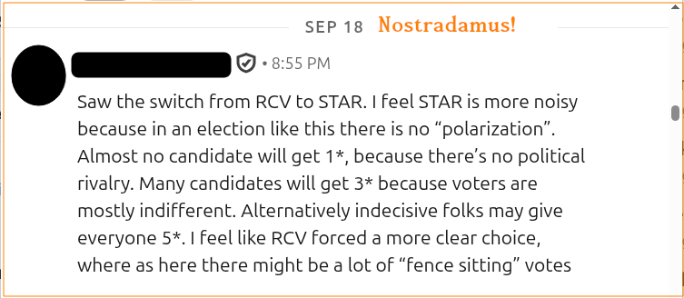
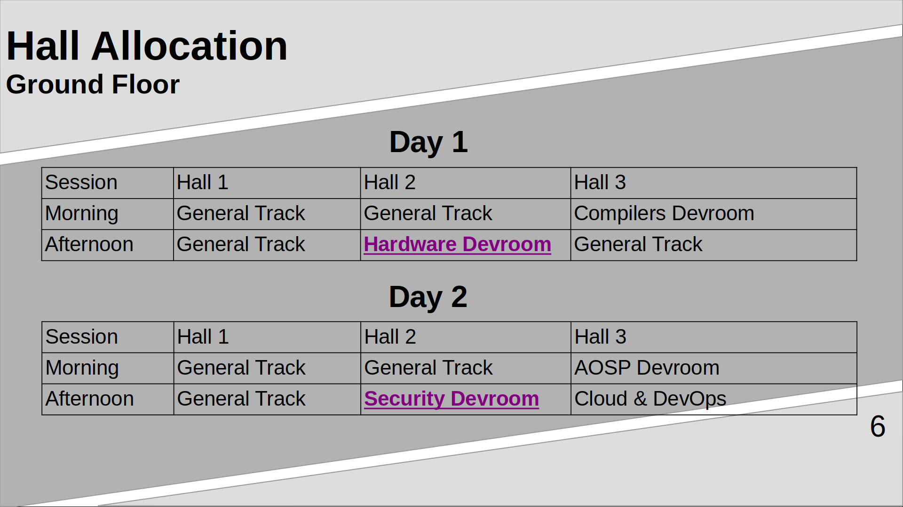
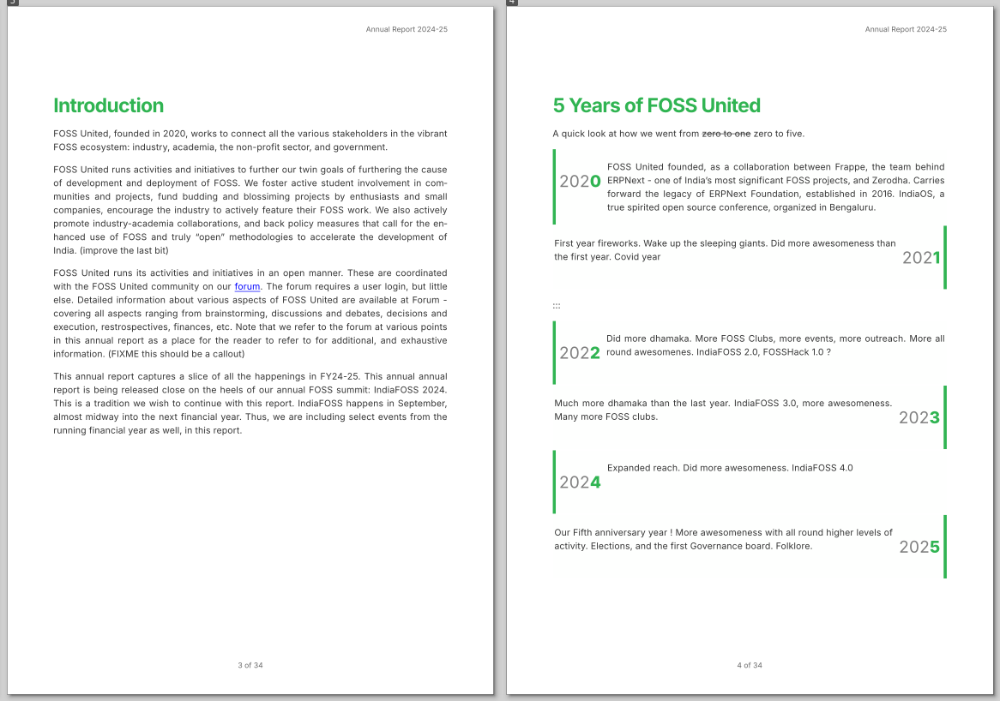
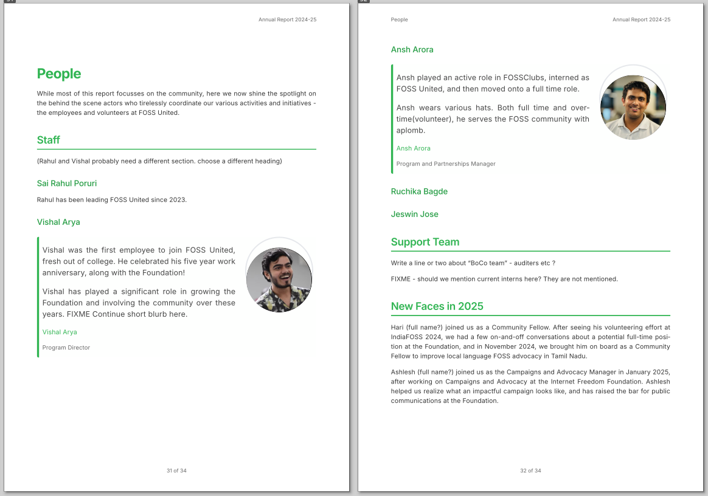
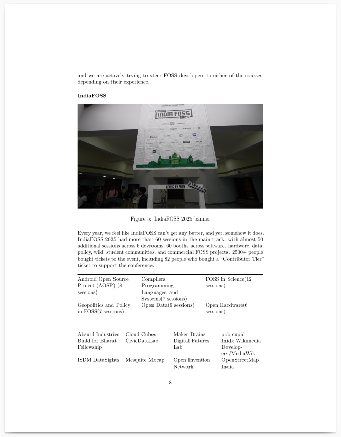
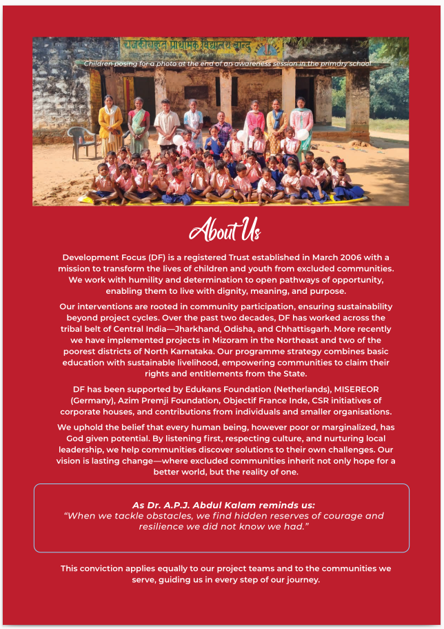
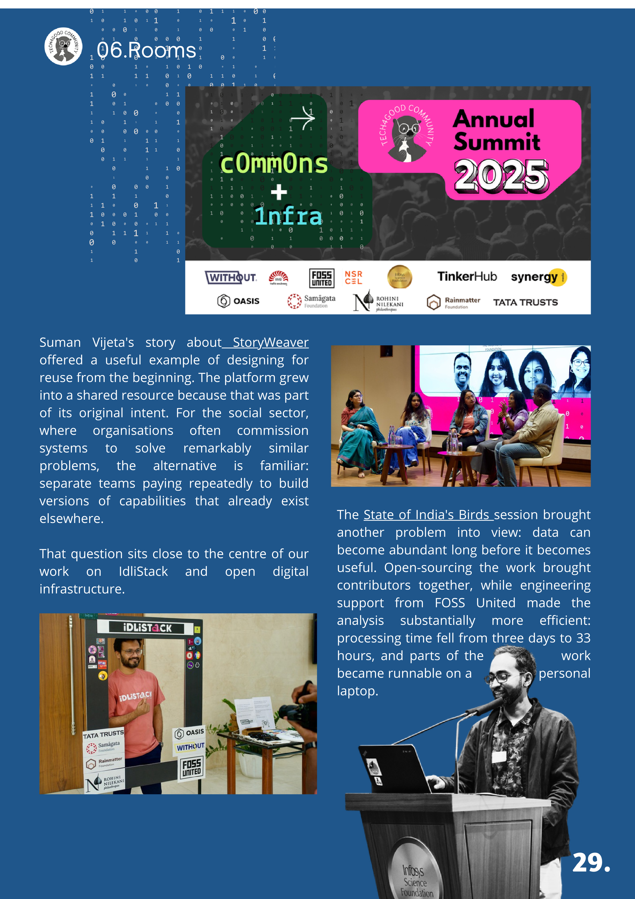

# What ails FOSS United Foundation

This post is a result of me distilling all my learning from the past two years. Over this period, I served as the Co-Chair of IndiaFOSS. I also served on the
first-ever elected GB, stepping down recently.

I was purely a volunteer during this period. Since the platform misses this "nuance" ([oh the irony!](https://github.com/fossunited/fossunited/issues/1818)), let me make this explicit - I was not paid at all for my time. I am not sure why nobody saw before me that "Staff" are labelled "volunteers" in the "platform".

TLDR: there is no TLDR, sadly. Do read till the end! Coffee optional, as this is guaranteed to wake you up!

# Terminology

FUF -> FOSS United Foundation. All Staff, including CEO, but excluding the directors.

"volunteer" -> in double quotes. Few people. Derisive referrence to refer to paid full time Staff, masquerading as volunteers on the "platform"

volunteer -> without quotes, italics, etc. The real deal. Many of them. They put in their own time and energy.

FUC -> FOSS United Community. Superset of those on the forum, the folks who come to our events, speakers, volunteers etc.

# What _really_ ails FOSS United (FU)

Community meets see lot of opinions aired freely. But nobody has really analysed in depth what the contributing factors are.  Many know something is wrong, some feel it in the air, and few in their bones. But exactly what ? This is my take.

## Inclusivity

FUF is not inclusive. Repeat after me till you get it - FUF is not inclusive. That's it in a nutshell.  And for those who disagree, I will next explain why I
think this is the root cause. But before that, let's understand what inclusive really means.

From the point of FUC, inclusive means the following(here "I" is the generic I, not a reference to me - the Author of the article):

- I1: I am welcome here (barriers to entry & stay)
- I2: I am not left out ("content" of events, involvement, etc)
- I3: My feedback is acted upon (a natural enabler for continued involvement)

There are three profiles of people I'd like to call out here:

- P1: Contributor. Speaker, workshop host, reviewer, etc
- P2: Organizer. Helps run the event, curates content.
- P3: Attendee. RSVPs to the event. May or may not attend! An attendee who came
  once may be termed a "tourist". A repeat attendee is a "regular".

Organizers will naturally be the least in number.  Contributors next highest, and there will be an overlap in these two profiles. Contributors in an event may also be attendees in another event, and vice versa.

An inclusive place will have high retention, an exclsuive place naturally leads to seeing a large newcomer crowd at every event. This is a repeating pattern in
FOSS United events, which has been noted before. Many have lamented in public and private about "too many new faces". I've been in multiple meetups in Bengaluru, and even observed at some point that we have good outreach, but low retention.

This is not theory - anybody who looks at event tickets at IndiaFOSS for 2 or 3 years can say how much of the crowd repeated. Similarly for city meetups, and so on. But I can't recollect anybody really analysing this with numbers, and certainly not "volunteers". This is part of the broader trend I see where people form an "opinion" without "data" - leading to the unhealthy habit of even people who have access "data" to forming "opinions" without analysis. If you are somebody who have access to this data, I'd encourage you to do an analysis, and look at retention, churn across months or years, as appropriate. AI can make short work of this, but be sure to anonymize identities, and then feed it anywhere else. Then reverse map to original identities. Look at what you can learn. Such an analysis may be trivially run on all the FOSS United events as a whole too!

People who lack this data of course will not be able to do such analysis. Here is a potential solution - [file a FRUIT - an RTI on FUF!](https://forum.fossunited.org/t/rfc-rti-for-foss-united/9417). FUF cannot give you personal data. But you could ask for data where the identities are anonymized. FUF makes available voter lists, etc already with such properties, so this is nothing new from that perspective.

Next I will specifically point out where FUF is NOT inclusive.

## Oldies !

At this point, FOSS in India may be considered a 30 year old - going back roughly to 1995ish. I have seen it flower, grow, flourish and wither. I first heard about Linux in college days, maybe in 1998. I started working in 2000, and my first job needed me to use Linux. I then got active in the FOSS scene - Linux/Bangalore 2004, FOSS.IN 2005/2006. I also spoke at FOSSMEET NIT Calicut 2nd edition IIRC.

Now, look at the age profile of attendees at our various events. We don't collect any data, so your guess is as good as mine.  IndiaFOSS has 30-40% students. Most of the others are software professionals, a small bunch of hardware folks at various levels of interest too, commons being mostly a fringe - driven primarily by Staff efforts. There is a small non-software crowd, and if you notice - the age profile of that crowd is higher !  But have we ever asked ourselves why we don't have amongst us the more experienced pros in higher numbers ? That's the diversity angle we are missing.

## Note to Staff

I have given enough credit publicly to many of you, where it was called for. A pat on the back is a foot away from a kick in the butt, goes the saying. So, naturally, the rest of this article has various levels of admonition. In general I try to follow the "praise publicly, scold privately" policy. However, that cannot hold for everything. This post concerns the community and the interactions of the entire foundation with us. Healthy communities tend to be noisy, and that is by design. If any of the following aggrieves you, and you feel that you cannot discuss it with me here for any reason, then contact me directly.

## Students

FUF has hare brained policies that defy logic, and push the boundaries of stupidity. No 1 in my list - we don't give certificates of participation. This is a huge problem for student attendees, and is a recurring painpoint even for our student volunteers.

I am particularly harsh in this case simply because this is one of those FUF policies that goes against the very grain of what we are trying to do. It's a massive mixture of hubris, delusion and fundamental misundestanding of accountability structures. Actively harmful policies disguised as "principle".

Now, look at the data. We have thousands of colleges, and a system that runs on "certificates". Colleges have a simple logic. Want attendance ? Get me a certificate. It's no different than that doctor's certificate you'd use for a sick leave :) And unlike companies that have built an entire verification system for weeding out fake job histories, colleges take your word for it.

The largest recent reskilling endeavour - which btw has been a smashing success - is NPTEL. NPTEL blends credibility of learning from IIT Profs and puts it into a certificate for a fee :) Very smart. And win-win for all.

If Staff do not fix this soon, I will go behind them with a stick. (Rhyming words and figure of speech of course). Or better yet - a bundle of them. Meaning - I will run a public signature campaign. You have been warned :)

This is frustrating because every year its a repeating feature. I have raised this multiple times. I have tried to remedy things as best as possible, sometimes running behind Staff to send "official" looking emails (heh - I don't have a FOSS United email account!). The same issue persists after multiple years, just that it aggravates during major events, and is promptly forgotten afterwards.

## Non-Professionalism, thy name is FUF

I have looked at all Staff profiles, and I'll only call two of them professionals - Siddharth, and Ashlesh. Ashlesh's LinkedIn profile shows that he spent more than 3 years at Internet Freedom Foundation. Siddharth similarly at Major Hacking League. And so that's my definition of a professional... Anyone playing a specialist role, where they honed that primary skill in a job outside FUF.

The last point is pertinent. Who will a newbie learn a skill in FOSS United from ? For those out of college, who at FUF will teach you the fundamentals of professionalism in that area? It should be obvious to anybody that entry level hires are a no-no at FUF - for the sake of career development of the person getting hired - if nothing else.

I have had many meetings with Rahul, who is the CEO of course, and now even a director at FOSS United. (Hmm - he didn't inform anyone in the forum, and
so we didn't congratulate him here?). Most of my interactions were cordial of course, but one thing stuck out as a sore thumb - the lack of connectivity at his end during many online meetings. Will call out only the Governing Board meetings, and IndiaFOSS meetings because on these he was not a volunteer. I don't grudge him sitting in a remote location in Himachal Pradesh or whereever, but I would surely expect a CEO paid 30 lakhs a year who extensively works out of remote areas to find better connectivity at designated meeting times. Just because the other person is a volunteer should not mean that their time is FREE. And the CEO should have lead by example.

This also has implications on inclusivity. Real professionals value their time, because that's all we have. Work life balance is a thing for a reason. And what happens when my "balance" intersects your "work" !? Point to ponder for Staff.

## Discriminatory Polices for Volunteers

"volunteers" and volunteers have different travel policies. Most "volunteers" are early career professionals. They take flights, stay in better hotels, and get their food costs reimbursed. Their travel policies are internal to FUF - ha!

And what about volunteers. For IndiaFOSS, we booked 100-ish accomodations in Zostel. Which probably worked for most. But what would the more experienced
volunteers do? Make their own stay arrangements, right.  Is that fair and right ?

And we should ask, is that not discriminatory in terms of Staff valuing their own time differentially wrt the community. If Staff is "working" during the conference, then the time of volunteers for that duration must also be evaluated professionally, and not on the whims and fancies of Staff.

To set the context, do lookup Rahul's Annual Report, which was recently presented at IndiaFOSS. The relevant lines from that report are:

>
> Travel Expenses 14,59,300 INR
>
> "Travel Expenses” above includes staff travel and stay-related expenditure
> for events, including FOSS United events.
>

On an average basis, that's easily 1.5 staff cost. On a per employee basis, this is just under 2 lakh rupees. On an absolute basis, this is roughly comparable to what IndiaFOSS paid for all the food served, excluding breakfast.

Here are the numbers for IndiaFOSS 2025 [source](https://forum.fossunited.org/t/indiafoss-2025-financial-report/6821)

>
> Stay - Volunteers	Travel ₹175,000
> Travel - Volunteers Travel ₹63,728
>

Less than 2.5 lakhs for 40-50 volunteers ? 5-7 thousand rupees a person, roughly ??

We are probably spending more than that on a one way ticket for most staff. And in that of course we are truly inclusive - Staff fly in from many places in the country, except maybe from the North East ?

## Mission Impossible

When you are a professional (ie a "volunteer" - paid for it), then organizing a conference shouldn't be mission impossible. First time, maybe yes. Second time maybe still. But third time ?

But that's exactly what the inside view of IndiaFOSS looks like. Year after year. Staff in zombie mode who have convinced themselves that there's simply no better way to pull things off - most just wrote exams a few years ago, and everything is still fresh in their memory. IndiaFOSS is exams.  Studies happen just before that. Do we pass or not ? We were fourth time this year at NIMHANS. We have probably had a few hundred folks more in the last two editions compared to the preceeding one. There is little institutional memory - and Staff keep relearning the same things every year, Ticket transfers are a mess.  Folks start looking at even T-shirt vendors with less than two months to go before the conference, without data on what size T-shirts are needed for speakers, sponsors, and so on. Ordering excess T-shirts at the cost of wasting money is not even a consideration. Mad scramble all aronund. Technology is not a solution to any problem in FOSS United Foundation. CLIs are dead, long live "UX". Clicking in the browser rules! Except that it doesn't scale to a two thousand plus people event. This paragraph looks like a rant, and I am clearly losing it. So, let me fix get back on track by telling you the story of the GB Elections.

26th of October 2025. Elections were happening in my apartment community, on the outskirts of Bangalore. It's large with 500+ houses I guess. The atmosphere was great. From that inspiration, I pitched the idea to Rahul: Let's run the elections during IndiaFOSS. Physical+Virtual voting at the same time. Spread awareness. Get more people involved. Rahul liked the idea. In the GB meeting on December 10, 2025 [minutes](https://fossunited.org/blog/organization/notes-from-the-december-2025-governing-board-meeting), we discussed and agreed to this. But only on **Sep 10, 2026** did Ashlesh send an email to two possible third party voting choices: BetterVoting (who we eventually used) and OpaVote - asking for cost etc. And after all that outsourcing, the actual vote was sent out one day later than planned. One of the Hardware devroom managers was a GB candidate, and he was informed in the nick of time to come and give his intro on Day 1 of the conference?  Ultimately, only 5 candidates were at IndiaFOSS. I don't know if the others did not show up because they were not informed, informed late, or some other reason. "Meet the candidates" was on the schedule when it went up (that title itself was suggested by Rahul IIRC). Now, that's Mission possible, made almost impossible and nearly botched up by poor planning and execution.

Ah - btw Rahul also unilaterally changed the voting system from Rank Choice Voting to Star Voting - that too after announcing the RCV for the candidates(!!!), which rightfully raised eyebrows. JIT compilation (aka Just-In-Time decision making) was in full swing by then. One of the candidates had a very good objection to it, which I relayed to Rahul too. But that was ignored. See the objection below, and read on.

After the election results were announced, Rahul came out with his own analysis of [a few things worth noting from the election](https://forum.fossunited.org/t/2026-governing-board-elections/8667/8) which has observations bordering on insuination. IndiaFOSS has 30-40% students, and if Rahul thinks that everyone (pros too, not just students) are going to read all instructions and vote, then he must ask himself whose fault that is! His next post on the topic was even more intriguing, noting that:

>
> You might have noticed that 985 voters are listed on the election page -
> but on the admin dashboard, we see 1131 people are listed as having voted
> in the election. We heard back from the bettervoting team that this
> difference is because of how they count abstentions!
>
> ...
>
> A ballot is counted as an abstention if the voter gave equal stars to
> everyone on the ballot, e.g., the voter gave 5 stars to all candidates.
>
> ...
>
> 146 ballots were counted as abstentions
>

Overall, Rahul clearly had no clue what he was going to put the voters through, and seems least concerned with the impact of his choices. And even with the all-perceiving Nostradamus around, the doubting Thomas ran things aground! Meaning, just consider this : if Rahul(the "doubting Thomas") had agreed to the objection raised by that GB candidate("Nostradamus"), there would have been no problem at all. This is the classic thing we all do in the software world: if it's not broken, don't fix it. Net net, Rahul did everything but acknowledge that he was treating an election with 25k potential voters as his private experimental playground.

## Ghost Protocol

Could have titled this "Feedback that vanishes into the void" too, but "Ghost Protocol" has a nice vibe to it. No, not Jeff Goldblum. Tom Cruise. And given that Tom Cruises, Rahul ???????? Let's start with feedback, and end with the ghosting.

FUF gets feedback. A lot of it. At various levels, and from all channels. Forms, email, telegram messages and in-person.

The following sentence is often used by our (Indian) judiciary. The milords frequently say:

> Justice must not just be done, but must seen to be done

What's that, translated to geek-speak ? Always give "attribution". E.g. we use CC-BY-SA-4.0 for all our content. When an idea comes from the community, and you implement it, then you attribute it back to exactly the same person(s) citing the right reasons. But what happens after FUF takes feedback ? The feedback mostly lands into the void.  And the ones that get considered, and things that get acted upon, the person who gave the feedback is left hanging.

Hopefully I have covered the extremities of the spectrum of the "Ghost Protocol", and left you, dear reader, with ample space for interpolation with your own data.

## There is No Smoke Without Fire

I have deviated significantly from the standard FOSS formula. So sorry - I almost forgot! Every FOSS project story must start with a personal itch... So, what is mine ? Reclaiming the glory days of FOSS - that it surely is. Maybe I am still stuck in the past. And yet I labour on.

Right now, some of you may be thinking - why did this joker NOT come out with some or all of these earlier. Surely, being on the GB for a year and a half, and working as an IF co-chair would mean that I would have had some idea beforehand. In some ways, yes, I had some of these insights earlier.  Less than a month ago I had said that [we have well intentioned staff - VIDEO LINK](https://youtu.be/16jUf3fLtsw?t=12818) in my GB Reflections talk. Thus, I had clearly not learnt the Public Policy lesson #1, which is:

>
> one must not judge someone by their intentions, only by their results.
>

I have seen people misunderstand what the GB means in the context of FOSS United. The draft constitution is available online. Here's how I see the GB: it's a bit like the judiciary, and making laws combined in one - which isn't usual. The judiciary generally waits for cases to be filed, and then acts on them. To be honest, I did push some staff in one particular instance (equivalent to suo-moto action), and got the matter resolved. Overall, very few "cases" were filed when I was on the GB - 4 or 5 maybe, including 2/3 by me. I have been out of the GB for a month, and am getting more time to interact with the community. Turns out some of them thought that I had become part of "the core team" or "the team", etc. This "othering" has really bothered me, but I won't go deeper into this aspect right now.

As Co-Chair of IndiaFOSS, I have intereacted with the Staff for 2 years. For the first year, I was a bit in observation mode, trying to correct things where possible. We also introduced devrooms, video recording and other things - that kept me occupied, but gave me a fair idea of what needs to be fixed. To be honest, I was surprised to find so much chaos. I had assumed that since the team had organized a conference in the past, it would be way more simpler.  Only when 2026 came around that I started figuring out what really ails FOSS United. No good processes. No learning from mistakes. Not even making a note of mistakes. No process improvements. So, this year I found that I was getting increasingly frustrated. Even budgets, there was not much rhyme nor reason to many decisions - though people clearly thought so. Right now, one month has passed after the conference.  And I haven't yet heard how many T-shirts are unsold - all this inspite of folks thinking they can make "money" selling them. I've found no real method to Staff madness, though I have tried hard. Folks don't even understand simple concepts of defining a budget, and keeping expenses in check.

Worse, I realized that FUF staff had less appreciation for the kind of skills they were getting for FREE by having me around.  I believe in consensus and have always operated with that, but consensus musn't mean dumbing down, and making bad decisions (responsibility is collective, right ?). I was trying to effectively use the venue and allocate space as fairly as possible. I like to work incrementally. So I proposed that Security and Hardware devrooms at-least get a bigger room - Security because it's a topic that anybody is generally interested in, and Hardware for a simiar reason - plus they are known crowd pullers. I proposed Audi 2 (Hall 2 - capacity 250). This was on August 12 - a month and a half before the conference. I presented a full set of slides - a lightning talk of sorts. Surely a first in the history of IndiaFOSS volunteer calls - I mean, imagine a conference Co-Chair giving a lightning talk for approval to everyone ! The presentation must have been solid, and I have good memory of Ashlesh complimenting me on this. Dunno if it was on the chat, or did the speak the words, "Rockstar Shree". The relevant slide I presented is below (color changed for emphasis):

But what happened afterwards ? Clearly some Staff had an idea that their ideas were better.  James (another Co-Chair) wasn't in the meeting that day either. Whoever was at the conference knows what eventually happened. Devrooms overflowed. And our biggest stage was running talks to empty halls - and did any Staff keep track of how many people were inside? I'd be curious to know. Even outside of Communi-Con, live voting was on, and the audience clearly voted with their feet. But did I hear any Staff say, "mea culpa", yet ? No, Sir!

This was also the point when I started realising what the impact of arbitrary Staff decisions can be, on real volunteers. Young or old didn't seem to matter much to Staff. Chilling effect ? Maybe, for students. But for working pros ? Who cares. In today, gone tomorrow!

Finally, let me return to the Annual Report of our NGO.  I have been a minor donor to many NGOs. Beyond personal interactions, the only way I evaluate an NGO is through their Annual Reports. NGOs clearly spend a reasonable amount of effort to make a good report for external consumptiom - it's an important part of fundraising strategy. So when I noticed Rushabh asking for accountability more than a year ago, and saw that he raised the issue without fail every year, I added this to my TODO list. Not because he is a co-founder of FOSS United, but because that's a tool I need. If I volunteer somewhere, that means I am spending time on a cause. Does the organization where I volunteer share that cause ? How much is the alignment ? If something is getting derailed, the signs are always in the Annual Report.

I was on the GB, so I set to work. I'd periodically remind the CEO to do his duty. I also noticed that Blender (one of my favourite tech projects), were releasing the Annual Report just in time for their flagship conference. This made sense for us too. And it was also good as there was ample time. So, in September the report was supposed to go out. For FY24-25. Meaning April 2024 to March 2025. The audited financials are typically the last to come - a minor, yet gating item. But the rest of the report tackles everything done half year before. So there's nothing last minute.  Mission Impossible was in full swing, and I was naive enough that I spent a week trying to make a "pretty looking" annual report to try mimic the other NGOs - with reasonable results (pandoc + AI etc).  I also proposed a "design hackathon" to make a pretty version. Staff uses Figma(go FOSS people!), and I proposed that they can give ideas, and get templates made by the community, etc. That idea was liked, but never implemented.  But shocking thing - even now there is no Annual Report published for 2024-25.

Then the ball rolled to 2026, and Mission Impossible was back for Season 2. After much pushing, out came [a markdown file on Sep 19](https://github.com/fossunited/annual-reports/blob/main/2025/report.md). Barely one a week before IndiaFOSS 2026! I sent Rahul some quick feedback, and attached my much nicer looking [annual report of the previous year](https://github.com/shreekumar3d/fossu-annual-report-2045-25). That PDF looks something like this:

Annual Reports are also about emotion - recognition, showing things in the "right light" etc are important. I am no "designer", but had spent some time on this angle, lest people miss it:

I hoped that Rahul would put together a much nicer one to show at IndiaFOSS and release it publicly. He has two dedicated full time employees - Jeswin and Ashlesh who could have done it. But no, he took the stage on Day 1 of IndiaFOSS, with what looks like an undergrad student report written in latex. An absolute horror. It looks nothing like what anyone should expect as an Annual Report of a Not-for-profit that runs on a 3 crore rupee budget in India! Heh - FUF puts in more effort to make a socials post on LinkedIn than this CEO put in for the entire Annual Report. Judge this for yourself:

How does high tech FUF compare to a typical non-tech Indian NGO ? Here is a sample:

NB: I have nothing to do with this NGO "Development Focus". It came up on a Claude search for an NGO with budget less than 2 crore.

And how does high tech FUF compare to another NGO in the same circle? Again, see for yourself how Tech4Good Community presents itself. Can you see the emotion ?

The selfie frame on that image is interesting too. "OASIS WITHOUT FOSS United" does not read well. I mean, the stickers on the selfie frame in that image! The WITHOUT logo has a registered trademark which isn't visible easily. Could be unintentional placement, but NGOs have a large messaging angle - so perhaps somebody must pay attention to this matter!

At this point, I can only see our "Annual Report" as a signal of "I don't care" to anyone outside FUF. And what has made this possible? The CEO has had no _real_ _need_
to raise money, and I'm not sure if this is something that he has had to work for at any point in his career. The sole Industry Partner that did demand accountability could not even get an Annual Report after repeated reminders and follow-ups for maybe two years.

I've also learnt much about the extent to which FUF is wasting precious funds. We spent 6 lakhs on accounting last year. That's rich even for an Indian business, leave alone a Not-For-Profit foundation. Heh - our CEO doesn't even understand simple accounting principles such as GST offsets - which saves taxes. If we need accountants for the CEO to explain his annual report prepared by him alone, then we are doomed. The Annual Report presentation at IndiaFOSS (livestream) has at-least two "halucinations" that are glaring:

- Frappe was an Industry Partner for FY25-26, and contributed 24 lakh rupees. Surely that's something the CEO is expected to know well enough ? Yet, he shows this as "IndiaFOSS 2025 Income", inflating its budget to 70.51 Lakh rupees. This may be an accounting fact, but does misrepresent what Frappe gave the money for - and they didn't give it specifically for IndiaFOSS 2025. From the community perspective, it felt weird that a supposed "explainer" from the CEO was actually a misleader. For reference, the correct figure is at this [forum post for IndiaFOSS 2025 financials](https://forum.fossunited.org/t/indiafoss-2025-financial-report/6821) which puts Sponsorships at 28L, and the overall income at 55.41 Lakhs. This doesn't account for GST offsets, but otherwise isn't too bad.
- The CEO blurred the lines quite a bit [right here - VIDEO LINK](https://www.youtube.com/watch?v=16jUf3fLtsw&t=11760s)... "like you noticed, our three anchor funders _are_ Samagata, Zerodha and Frappe. We are trying to reduce our institutional risk.. because again effectively that means any of these organizations go down tomorrow or for whatever reason decide to pull funding then we are in a big pickle..".  Of course, Rahul knew full well that Frappe had opted out and did not renew Industry partnership for FY26 - the running year - and had already pulled funding. They went from 24 L to 2.5 L, sponsoring only IndiaFOSS this year at a 50% discount to make their point very clear. So, was the CEO misrepresenting reality in front of the community, or living in the past during his presentation ? Annual report presentations must be about explanations - not obfuscations.

Rahul casually mentioned in the same presentation that almost 54 Lakhs was surplus - i.e. left over in FY25, put into a fixed deposit. That's almost 20% of the overall money *unspent*. Here's the kicker. The fact that FOSSU had such a large surplus was **never** mentioned in any GB meeting. In fact, I have never been shown the audited financials for last year - or the one before that either.

FUF had sponsored some folks to attend FOSDEM on a pilot basis. International travel is not for those without deep pockets. Staff had decided that [1 Lakh is the right budget cap](https://fossunited.org/blog/organization/notes-from-the-february-2026-governing-board-meeting), which seemed reasonable standalone, but did they even know _themselves_ at that
time that they had 50 lakhs lying in the bank ? One of the grantees left this comment on the same GB meeting notes:

>
> A high amount considering FU's yearly budget for grants, but for the individual
> making the travel, it is no where near enough. Personally speaking, owning to
> expenses incurred, I skipped a meal & sometimes 2 meals every single day
> I was in Europe.
>

We hear about governments unable to spend money, and incessant debates about it, and sometimes our public policy experts also chime in there. But that the same phenomenon can be replicated in FUF at such a small scale, and passed off as a ["feature" in the CEO's presentation - VIDEO LINK](https://youtu.be/16jUf3fLtsw?t=10709) has been an eye opener for me, truly.

So, lastly a word about public policy and advocacy efforts of FUF. These are mostly Staff driven efforts. There is some feeble community involvement - I've attended a couple of calls too btw. It is now clear to me that most people do not understand the true nature of what FOSS represents. It's a unifying theme - mooted in the past. An effort to unify the Free Software Movement and the Open Source world. Note that FOSS is a union of the two. I find that many in the "Free" camp regularly misunderstand the acronym FOSS to mean "Free software", resulting in interesting "FOSS advocates". But no, it is NOT limited to that. Using the word FOSS conceeds that everyone has a right to make a living out of the software - that's precisely what the O in Open represents. And that, by extension means a healthy regard for Patents and other forms of Intellectual Property. This is ultimately what the Open source licenses encode in legalese.

So - what about "FOSS" ? FUF recently had a public policy "win" - an [article in the Hindu Newspaper](https://www.thehindu.com/sci-tech/technology/over-134-crore-spent-on-proprietary-software-at-premier-institutes-says-open-source-collective/article71428079.ece) . Was it online only - or actually printed in a physical edition I know not. The article extensively used the term "open source". The article uses the acrynom "FOSS" as a **noun** only - i.e. only in "FOSS United" and "IndiaFOSS". So, FOSS is dead, well and truly. And the proof is provided, partly courtesy FOSS United's public policy efforts.

The GPLv3 family of licenses are soon gonna celebrate 20 years of existence. Right now, the best example of "Open Source Software" is the Linux Kernel. And anybody who thinks that the Linux Kernel is "Free" software is conveniently living in the past, confusing availability to mean "true" freedom, or worse: reading the GPLv2 text, written in 1991, which is "This program is Free software..." in a literal sense in 2026. Is it really ? :) For those who don't yet believe me - lookup the Open Innovation Network(OIN). They do a great job of protecting Linux and Open Source technologies from "Patent Trolls". Yeah - they protect who ? Big tech, small tech, all tech and no tech too. You and me - all of us. They pool patents, and prevent patent aggression.  So, Free Software advocates, kindly note - if you are using the Linux Kernel - directly, or indirectly - then you are collateral beneficiaries of OIN. Now, that must be a sobering thought, philosophically speaking. If you feel unhappy, just uninstall the Linux Kernel first. And if you want to keep the Penguin - especially the newer versions, that's cool too. And just stop debating about "Free Software", as Free... is, was, and has been dead for a while. Long live Open!

## Persons of Interest

FUF isn't the only NGO out there. There are others that Rahul is in constant touch with. OASIS, Tech4Good, IFF, and I don't know who else. With so much exposure to the NGO circuit, I was expecting Rahul to adopt the best in class practices of transparency and reporting. Internet Freedom Foundation(IFF) seems to be the [gold standard here](https://internetfreedom.in/organisational-donors-and-supporter/), showing Balance Sheets, ITR filings, and full details of Organisational donors.

So - where does FOSS United Foundation stand? Have a look yourself. We stand alone. We learn from no one. I recently asked Rahul, rather curtly over WhatsApp, "Exactly who is FOSS United getting its best practices from?". He conveniently avoided that question. Such tactics do not work with me, and ultimately I am forced to ponder what is he really trying to achieve here! Hiding things is indeed a slippery slope - it leads to a trust deficit, and we are all pushed to doubt, every so slowly but surely.

And it's not as if FOSS United was always like this. We have internally published audited financial reports of [FY21-22](https://forum.fossunited.org/t/foss-united-financials-22-23/2478) and [FY22-23](https://forum.fossunited.org/t/foss-united-financials-22-23/2478), but after that what? I've been looking at other things also. I noticed that there was [a recorded "Open Mic" feedback session in IndiaFOSS 3.0 - VIDEO LINK](https://www.youtube.com/watch?v=wJFsqLCygRk), and even a ["Future of FOSS United" Discussion at IndiaFOSS 2.0 - VIDEO LINK](https://www.youtube.com/watch?v=EBD-Un3CvPw&list=PLOGilj110olwC-o9Uzj8F0p3OlmLFw6K2&t=0) all of which in hindsight look like great ways of actually taking and tracking feedback, and provide valuable understanding of the state of IndiaFOSS, the nature of interactions in the community, and so on. And did we stop this in 2024 - damn - and WHY !? Anybody knows ? Somehow I was under the mistaken notion all this while that this was "tradition" :facepalm: Feeling a bit sorry now - if anybody told me that FUF had become "corpo" and I disagreed, it was without this knowledge. 

Finally - something for the oldies, from the pre-Rahul era. There is something that totally beats me even now. I find it mildly amusing, and highly intriguing. Around two and half years ago, the co-founders of FOSS United more or less decided that they wanted to stop policy stuff at the foundation. At the end of that long debate with several undesirable twists and turns, we had a real org change. Rahul was hired, and [everyone was all smiles](https://forum.fossunited.org/t/request-for-comments-foss-united-public-policy-roadmap-for-fy-24-25/3139/30). In this I have the benefit of hindsight of course, and here's what I keep wondering - would the co-founders have even imagined in their wildest dreams, that the same guy they hired would eventually keep the policy flame alive and burning, run sprints and background marathons, and generally keep the money flowing exactly where there was neither community driven requirement, nor consensus? See [this FRUIT - RTI on FUF!](https://forum.fossunited.org/t/rfc-rti-for-foss-united/9417/3)
 
Hopefully I have demonstrated rather comprehensively the extent to which the CEO of FUF has misplaced priorities and is missing fundamentals essential for his current roles. To me, these deficiencies are a contributing factor to all that which ails FOSS United Foundation.

So - my unsolicited, but well considered advice to the current CEO: Making a song and dance of "principles" can come later. First focus on the fundamentals, please. Anyone who has seen the world learns to judge based on actions alone - talk is cheap, show me the .... ?

I've avoided so far any thoughts that anybody here is running around with mala-fide intentions, but only complete transparency can satisfy me at this point. This article does poke a bit of fun here and there, and that is done to make things easier to read, and hey - I am human and need to vent a bit too. All said, do consider this my satyagraha - read in kannada as satya + aagraha. i.e. insisting you - the reader - and all of us, individually and collectively, to look for the truth.

This sub-section could have been titled ["Byomkesh Bakshi"](https://en.wikipedia.org/wiki/Byomkesh_Bakshi) too, but I chose "Persons of Interest" as it has a nice ring to it, and is high tech to boot. Hopefully, this tiny tidbit makes this article even more inclusive.

And for the benefit of the reader who may not know me : I am a full stack _paisa_ _vasool_ systems architect by trade. I have worked for more than 23 years in the industry, done services and products, in various domains ranging from supercomputing to embedded. I've mostly been an Individual Contributor - and I have handled plenty of budgets and people. I do spend some time now volunteering, and some work for Non-profits. I like Free Software, Open Source, Open Hardware, Open Dosa (_specifically_ Davanagere style Open Dosa), Open and closed/broken Roads and Free Air - and every one of those for very good reasons. And to be very clear - note that my "corpo-rate" is INR 1 crore+ when working full time, same as the entire FUF staff budget. Fair as my overall experience is comparable to their sum too. So please don't underestimate what volunteering brings to the table for even one moment.

## Afterword

So, what next for FOSS, you ask ? When you meet me next, I'll try to convince you that it's actually "open source dharma".  Dharma is our civilizational notion of "right and wrong". Dharma means "support" of various types.  "FOSS grants" in my dict are beyond "software dharma" - as we do support hardware and the wider digital commons too. So "tech dharma" is what we really do - the one true dharma encompassing everything+tech :) Software, hardware, data, design, etc are clothes, but the soul is open(as in "transparent") tech.

One way to do your tech dharma - please do checkout [The Rupee Fund](https://rupeefund.org). It's a UPI based fund for Free and Open projects - where you fund others - from Software to Silicon. Our idea is simple. We believe that projects must first be encouraged by "you" and "us", and then the world will follow. 

And anybody can do it, starting at 15 rupees a month. Are you somebody who thinks that you can make a difference, or do you think someone else must fund "FOSS"? You can keep waiting, or take a small step today.  Check us out now at [https://rupeefund.org](https://rupeefund.org) and sign up today!

A small step for you, a big step for FOSS. Take it today, BOSS !

And do consider making a difference by volunteering at FOSS United too. In spite of all my critique above, the fact remains that it's not such a bad place after all. And the only real fix is for the community to come and run what's relevant to them. See you around!

Have thoughts ? Do make your own arguments about "what ails FOSS United". Hopefully you can find flaws in these arguments. Perhaps I did miss something, misinterpreted something, or some context - feel free to point those out. I can't bring private verbal discussions here - so have taken reasonably pains of restricting myself mostly to known public, referrable things. Personal experiences are acceptable (I did that too!), but do make them insightful. Quoting written private conversations is also acceptable, and use those with care. Anybody else coming to the party, request you to follow broadly similar rules as well.

What next for FOSS United Foundation ? How do we go about making it better? One tome deserves another, but the volunteer in me is hard at work now. So you'll have to wait for my next article. This one is landing on Vijaya Dashami. Next one will drop on Deepavali/Diwali. Stay tuned, may the light shine on us all. Let the real festivals begin!
